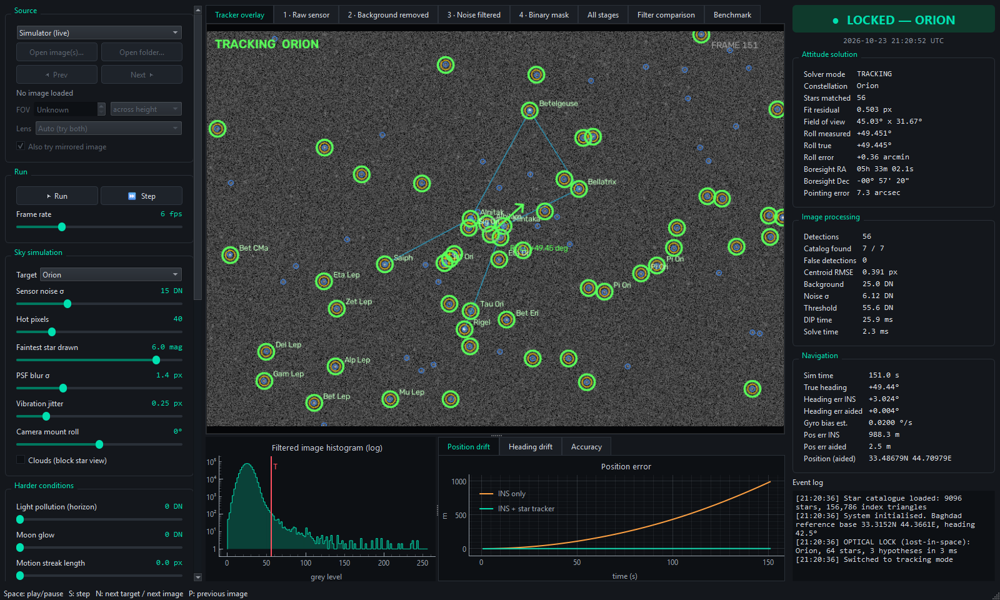
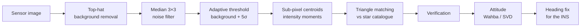
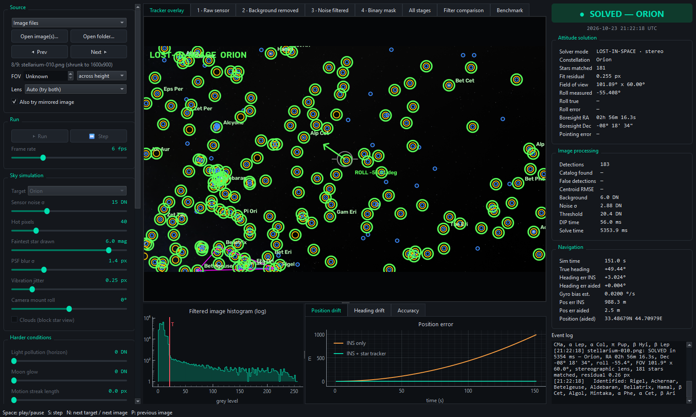

# AstraNav

**A star tracker for GPS-free navigation, built with classical digital image processing.**

AstraNav finds the stars in a camera frame, recognises which stars they are, works out which way the camera points, and uses that heading to stop an inertial navigation system from drifting when GPS is unavailable. No neural networks: every stage is a classical DIP technique, chosen and tuned by measurement.

*Digital Image Processing semester project · University of Technology – Iraq, College of Computer Engineering · 2026*



## Why

GPS can be jammed, spoofed or simply absent. Inertial navigation needs no signal, but it integrates gyroscope readings, so a tiny gyro bias grows into a large error: in our simulation a 0.02 °/s bias puts an aircraft **3,883 m off course after 5 minutes**. The stars are a reference that cannot be jammed. With AstraNav's star fixes the same flight ends **5.4 m** off course.

## How it works



| Stage | Technique | Why |
|---|---|---|
| Background removal | Morphological top-hat (21 px disk) | Moon glow and light pollution make one global threshold impossible |
| Noise filter | Median 3×3 | A hot pixel is never the median of its neighbourhood, so it is removed while stars survive |
| Threshold | Background + 5σ, estimated with 3σ clipping | Follows the measured noise; Otsu fails because the sky is ~99.9 % background |
| Centroiding | Intensity-weighted image moments (m10/m00, m01/m00) | Places each star to a fraction of a pixel |
| Identification | Rotation- and scale-invariant triangle side ratios, 156,786-triangle index of the whole sky | Works for any part of the sky with no prior knowledge ("lost in space") |
| Verification | Project the whole catalogue; must beat chance and explain the brightest stars | Prevents confident wrong answers |
| Attitude | Wahba's problem solved with an SVD | Gives pointing (RA/Dec), roll and, for unknown cameras, the field of view |
| Navigation | Heading correction + gyro-bias estimate | Keeps dead-reckoning error at metres |

Every alternative was implemented and compared (no filter, Gaussian, bilateral; Otsu and fixed thresholds; median background subtraction; binary-shape centroids), and every parameter (kernel size, k, structuring element, minimum blob area) was chosen from a measured sweep. Those experiments run from the GUI's Benchmark tab or `benchmark.py`.

## Results

Measured on synthetic frames with exact ground truth (30 frames per point) and on 9 Stellarium screenshots.

| | Result |
|---|---|
| Correct identification, default conditions | **100 %**, no wrong answers |
| Centroid accuracy | **0.43 px** RMS |
| Heading (roll) accuracy | **0.8 arcminutes** RMS |
| Real Stellarium skies identified, no hints | **9 / 9**, fit residual 0.1–1.2 px in 8 of 9 |
| Navigation error after 300 s | **5.4 m** with star fixes vs 3,883 m gyro only |
| Speed | ~16 ms image processing + ~3 ms solve (~1 ms when tracking) |

Removing a single DIP stage breaks the system: without background removal, a bright moon gives 0 % solved frames and up to 23 % *wrong* attitudes.



## Run it

Requires Python 3.10 or newer.

```bash
pip install -r requirements.txt
python astro_inertial_system.py
```

The first start builds the triangle index from the star catalogue (a few seconds) and caches it in `data/`.

**In the app**

- **Simulator (live):** a synthetic star camera rolls with the vehicle heading. Change sensor noise, hot pixels, moon glow, light pollution, motion streaks and clouds, and every DIP setting, while it runs. Tick *Clouds* to watch the navigation drift and recover.
- **Image files:** solves real sky images in `images/` (or any you open). Set *Lens* to *Auto*; Stellarium screenshots use a stereographic projection, real cameras a pinhole one.
- **Tabs:** each pipeline stage, a side-by-side filter comparison, and a Benchmark tab for parameter sweeps.
- **Keys:** Space play/pause · S step · N next target or image · P previous image.

**Benchmarks from the command line**

```bash
python benchmark.py --sweep "Moon glow" --compare "Background removal" --frames 30
python benchmark.py --all results --frames 30
```

The second command runs every experiment and writes one CSV per experiment to the `results` folder.

## Project structure

| File | Contents |
|---|---|
| `astro_inertial_system.py` | Entry point, launches the GUI |
| `gui.py` | PySide6 + pyqtgraph interface |
| `sky_sim.py` | Synthetic sensor images rendered from the real catalogue (noise, hot pixels, glow, streaks, clouds) |
| `dip_pipeline.py` | Background removal, noise filters, thresholding, connected components, centroiding |
| `solver.py` | Lost-in-space triangle identification, verification, tracking mode |
| `attitude.py` | Projection (pinhole and stereographic) and Wahba / SVD attitude |
| `star_catalog.py` | Yale Bright Star Catalogue loader |
| `catalog.py` | Constellation targets and stick figures, coordinate formatting |
| `nav.py` | Gyro dead reckoning with star-tracker correction |
| `metrics.py` | Accuracy against simulator ground truth |
| `benchmark.py` | Monte-Carlo parameter sweeps |
| `image_source.py` | Loading real sky images |
| `data/bsc5_catalog.gz` | Star catalogue (9,110 entries) |
| `images/` | 9 Stellarium screenshots used for validation |

## Data and references

- Star catalogue: D. Hoffleit and W. H. Warren Jr., *The Bright Star Catalogue*, 5th revised ed., Yale University Observatory, 1991 (CDS/VizieR V/50).
- Validation images rendered with [Stellarium](https://stellarium.org).
- R. C. Gonzalez and R. E. Woods, *Digital Image Processing*, 4th ed., 2018.
- E. J. Groth, "A pattern-matching algorithm for two-dimensional coordinate lists", *Astronomical Journal* 91, 1986.
- G. Wahba, "A least squares estimate of satellite attitude", *SIAM Review* 7(3), 1965; F. L. Markley, *J. Astronautical Sciences* 36(3), 1988.
- C. C. Liebe, "Star trackers for attitude determination", *IEEE AES Magazine* 10(6), 1995.

## Team

Haider Fouad (team leader) · Narjis Saad · Sama Samir · Hajar Ahmad · Shireen Salim

Supervised by Dr. Saja Dheyaa Khudhur and Dr. Sama Salam Samaan.
